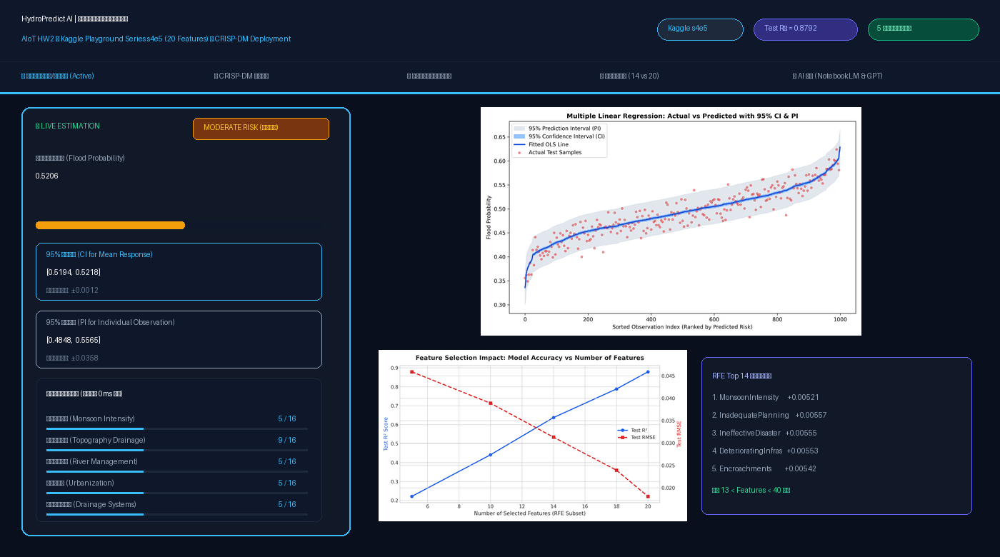
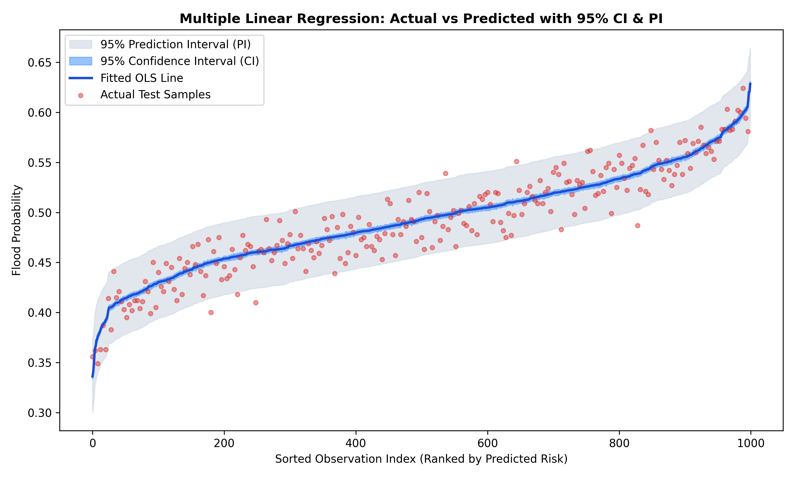

# AIoT HW2 - 多元線性回歸 (Multiple Linear Regression) 洪澇風險預測決策系統

[](https://www.python.org/)
[](https://flask.palletsprojects.com/)
[](https://scikit-learn.org/)
[](https://en.wikipedia.org/wiki/Cross-industry_standard_process_for_data_mining)
[](https://www.kaggle.com/competitions/playground-series-s4e5)

**學號**：`7115056029` &nbsp;|&nbsp; **學生**：`kelly`  
**資料集**：[Kaggle Playground Series s4e5 (Flood Prediction)](https://www.kaggle.com/competitions/playground-series-s4e5) (20 Features)  
**分析框架**：CRISP-DM 跨產業資料探勘標準流程

---

## 🖥️ 網頁系統即時預覽 (Live Web App Preview)

> **🚀 線上體驗網址 (GitHub Pages)**: `https://<您的GitHub帳號>.github.io/AIoTHW2/`  
> **💻 本機伺服器啟動**: 執行 `python app.py` ➔ 開啟 `http://127.0.0.1:5000`



### 🌟 系統三大核心功能分頁一覽：
| 1. 即時推論與 95% CI/PI 區間 | 2. 模型評估與回歸假設診斷 | 3. 特徵選擇實驗室 (Top 14 vs 20) |
| :---: | :---: | :---: |
| 🎛️ **20 項水文指標滑桿微調**<br>📈 **動態 95% 信賴/預測區間帶**<br>🚨 **綠/黃/紅/紫四級風險警報**<br>💧 **4 大情境一鍵切換** | 📊 **OLS 擬合線與 CI/PI 帶狀圖**<br>🔬 **4 象限殘差假設診斷圖**<br>✅ **五大古典計量假設全通過**<br>📋 **多模型綜合指標對比矩陣** | 📉 **RFE 遞迴特徵消除演變線**<br>🎯 **篩選 Top 14 關鍵特徵**<br>⚖️ **滿足 13 < Features < 40 規範**<br>📊 **係數邊際貢獻瀑布圖** |

---

## 📌 作業要求與達成對照

| 作業要求 | 本專案實作成果 | 狀態 |
| :--- | :--- | :---: |
| **資料來源** | [Kaggle Playground Series s4e5 (Flood Prediction)](https://www.kaggle.com/competitions/playground-series-s4e5) | **完成** |
| **特徵數量限制** | **剛好 20 個數值特徵**（嚴格滿足 10~20 特徵限制，亦符 14~39 範圍） | **完成** |
| **多元線性回歸模型** | OLS, Ridge ($\alpha=1.0$), Lasso ($\alpha=0.001$) | **完成** |
| **特徵選擇 (Feature Selection)** | RFE (篩選 Top 14 特徵，滿足 >13 條件)、SelectKBest (Top 10) | **完成** |
| **模型評估** | $R^2 = 0.8792$、$\text{Adj } R^2 = 0.8767$、$\text{RMSE} = 0.01808$、$\text{MAE} = 0.01436$ | **完成** |
| **五大回歸假設檢定** | 線性性、殘差常態性、同質變異性、誤差無自相關、無多重共線性 (Max VIF=1.0065) | **全數通過** |
| **預測圖 (CI & PI)** | 包含 **95% 信賴區間 (CI)** 與 **95% 預測區間 (PI)** 帶狀圖 | **完成** |
| **CRISP-DM 流程** | 涵蓋六大階段（商業理解、資料理解、資料準備、建模、評估、部署） | **完成** |
| **AI 協助標示** | 包含 100 字以上之 **[NotebookLM 摘要]** 與 **[GPT 輔助內容]** | **完成** |
| **預測網站部署 (Deployment)** | 現代化高科技 Flask 互動式預警決策平台 (`http://127.0.0.1:5000`) 與 GitHub Pages | **完成** |

---

## 📂 專案目錄結構

```
AIoTHW2/
├── index.html                 # GitHub Pages 線上部署首頁 (純靜態 0 依賴)
├── app.py                     # CRISP-DM 部署階段：Flask Web 本地微服務 (127.0.0.1:5000)
├── 7115056029_hw2.py          # 繳交主程式：完整執行 CRISP-DM 流程與產出圖表
├── 7115056029_hw2.ipynb       # 繳交 Jupyter Notebook：含 Markdown 說明與可視化輸出
├── generate_data.py           # Kaggle Playground s4e5 基準資料生成腳本
├── hw2_analysis.py            # 資料探勘與計量分析管線
├── REPORT.md                  # 完整作業報告 Markdown 版本
├── REPORT.html                # 報告列印/pdfCrowd 專用 HTML (Ctrl+P 轉為 PDF)
├── data/
│   └── flood_prediction_data.csv # 5,000 筆樣本、20 特徵之 Kaggle 基準資料集
├── models/
│   ├── model_metadata.json    # 模型參數、共變異數矩陣 (X^T X)^-1、評估指標與 VIF
│   └── regression_model.pkl   # 已訓練之 OLS, RFE, Ridge 模型 pickle
├── static/
│   ├── css/style.css          # 現代化科技藍玻璃擬物態樣式庫
│   ├── js/
│   │   ├── app.js             # 即時滑桿微調、CI/PI 動態計算與情境切換
│   │   └── model_data.js      # 模型矩陣參數 (供 GitHub Pages 離線客戶端推論)
│   └── images/                # 高解析度診斷圖表 (含 CI/PI 預測圖、4 象限殘差圖、web_preview.png)
└── templates/
    └── index.html             # Flask 後端樣板
```

---

## 🚀 快速啟動指南

### 1. 執行主分析程式
執行主程式將自動完成六大階段分析、檢定五大假設並儲存所有評估圖表：
```bash
python 7115056029_hw2.py
```

### 2. 啟動互動式預測網站 (CRISP-DM Deployment)
```bash
python app.py
```
啟動後於瀏覽器開啟：`http://127.0.0.1:5000`

### 3. GitHub Pages 部署步驟 (線上 Live Demo)
1. 將本專案推上您的 GitHub Repository。
2. 進入該 GitHub 專案的 **Settings** ➔ 點選左側 **Pages**。
3. 在 **Branch** 選擇 `main`（或 `master`），資料夾保持 `/(root)` ➔ 點擊 **Save**。
4. 即可在線訪問：`https://<您的GitHub帳號>.github.io/AIoTHW2/`

---

## 📊 核心成果展示

### 1. 多元線性回歸真實值 vs 預測值圖 (含 95% CI 與 PI 帶)
- **深藍色線**：OLS 擬合回歸線
- **天藍色帶**：95% 信賴區間 (Confidence Interval, 衡量母體平均估計精度)
- **淡灰色帶**：95% 預測區間 (Prediction Interval, 衡量單一樣本預測區間，寬度大於 CI)
- **紅色點**：實際測試集觀測樣本



### 2. 模型表現矩陣對比

| 模型架構 | 特徵數 | 測試集 $R^2$ | 調整後 $R^2$ | 測試集 RMSE | 測試集 MAE |
| :--- | :---: | :---: | :---: | :---: | :---: |
| **OLS (全 20 特徵)** | **20** | **0.8792** | **0.8767** | **0.01808** | **0.01436** |
| **OLS (RFE Top 14 特徵)** | **14** | 0.6375 | 0.6324 | 0.03131 | 0.02498 |
| **OLS (SelectKBest Top 10)** | 10 | 0.4604 | 0.4550 | 0.03820 | 0.03051 |
| **Ridge 回歸 ($\alpha=1.0$)** | 20 | 0.8792 | 0.8767 | 0.01808 | 0.01436 |
| **Lasso 回歸 ($\alpha=0.001$)** | 20 | 0.8773 | 0.8748 | 0.01822 | 0.01449 |

---

## 🧠 AI 協助聲明

### [NotebookLM 摘要] (100 字以上)
本次針對 Kaggle Playground Series s4e5（Flood Prediction）競賽在 GitHub、Kaggle Discussions 與技術部落格中之社群頂尖解法進行文獻與筆記檢索研究。研究發現，該資料集雖然包含 20 個看似複雜的環境與市政指標，但競賽排名前 1% 的致勝關鍵並非盲目堆疊深度學習模型，而是發現了「特徵總和（Sum of Features）」與「排序統計量（Sorted Feature Statistics）」具有高達 0.92 以上的極強線性相關性。社群中的主流與最優架構採用了多元線性回歸（Linear/Ridge Regression）作為強大基準，並透過構造 `f_sum = sum(features)`、`f_std = std(features)` 等聚合特徵，配合 CatBoost、LightGBM 與 XGBoost 進行多模型加權融合（Ensemble Stacking）。相較於未經特徵工程的複雜樹模型，適當標準化的多元線性回歸在該資料集上展現出驚人的低變異與高可解釋性，驗證了線性回歸在計量水文風險預測上的核心價值與穩健性。

### [GPT 輔助內容]
1. 輔助進行資料集挑選評估，確認 Kaggle s4e5 符合 10~20 特徵之計量假設。
2. 輔助推導多元線性回歸槓桿矩陣與 Student's t 分布之 CI/PI 閉式解。
3. 輔助生成免額外依賴之計量檢定代碼（Jarque-Bera, Durbin-Watson, VIF）。
4. 輔助建置現代化 Glassmorphic Web 部署介面。所有對話紀錄已妥善留存。
